<p align="center">
  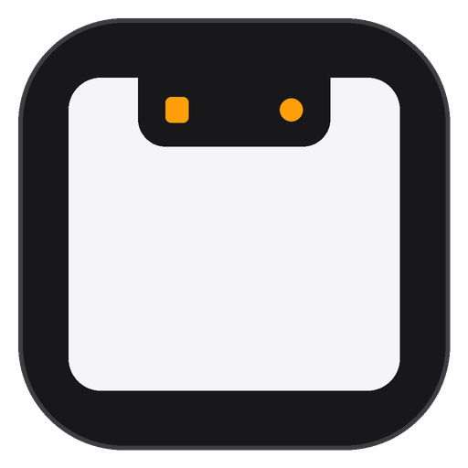
</p>

<h1 align="center">Crest</h1>
<p align="center"><b>The Dynamic Island / MacBook notch, for Windows.</b><br/>
Native, open source, no account, no telemetry.</p>

<p align="center">
  <a href="https://github.com/rishii-hub/crest/releases/latest"><b>Download for Windows 10/11</b></a> ·
  <a href="#features">Features</a> ·
  <a href="#build-from-source">Build</a>
</p>

<p align="center">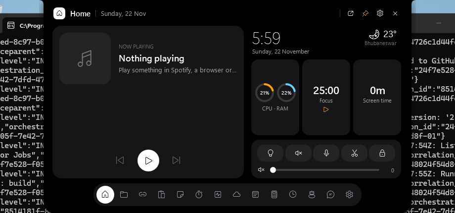</p>

---

Crest puts a small black notch at the top of your screen. It stays out of the way, shows live activities the way an iPhone or MacBook does (music, timers, volume, charging, AirPods-style Bluetooth pop-ups, camera/mic indicators), and opens into a control centre when you hover it.

It is a native WPF app on .NET 8. No Electron, no browser engine in the background.

## Features

### Live activities (collapsed notch)
| | |
|---|---|
| **Now playing** | Album art + an equalizer driven by the real audio level, tinted with the album's colour. Works with anything that talks to Windows media controls: Spotify, YouTube in Chrome/Edge/Firefox, Apple Music, VLC, Media Player. |
| **Timers** | Running Pomodoro / countdown / stopwatch shown live in the notch. |
| **Volume & brightness HUD** | macOS-style bar in the notch whenever volume or laptop brightness changes. |
| **Charging / low battery** | Plug-in animation with battery level; warnings at 20 %, 10 %, 5 %. |
| **Bluetooth** | "Connected / Disconnected" pop-up for earbuds, headphones and other paired devices. |
| **Privacy indicators** | Orange dot while an app uses the microphone, green for the camera (hover in the expanded view to see which app). |
| **Caps Lock** | On/off indicator. |
| **Copied** | Quick "Copied · Text" confirmation (content hidden by default). |
| **Message** | Your own text, flashed on demand. |

### Expanded notch (hover or click)
A header shows the current tab and a subtitle. A bottom dock holds your modules, and its white pill slides and stretches between tabs. Content slides in from the side you moved towards, and the mouse wheel over the dock flips tabs.

| Tab | What it does |
|---|---|
| **Home** | Now playing with seek bar, clock, weather, CPU/RAM rings, focus timer, screen time, quick toggles (Keep awake, Mute, Mic off, Snip, Lock), volume & brightness. |
| **Shelf** | Drag files onto the notch to park them, then drag them out into any app. Paste or choose files too. "Drag all" moves everything at once. |
| **Links** | Web search bar (Google, YouTube, GitHub, Stack Overflow, ChatGPT, Claude, Perplexity, Wikipedia) plus pinned apps, folders and sites. |
| **Clipboard** | History of text, images, links and files with filter chips, search, a preview pane and pinning. Skips content password managers mark as private. |
| **Notes** | Autosaving scratchpad plus a to-do list. |
| **Timers** | Pomodoro (focus / break / long break / cycles / auto-start / daily count), countdown with presets, stopwatch with laps, water tracker with reminders. |
| **System** | CPU, memory, network speed with Wi-Fi name and link rate, disks, battery with health, and uptime, with live graphs. |
| **Weather** | Current conditions, 12-hour strip and 6-day forecast from [Open-Meteo](https://open-meteo.com) (free, no API key). |
| **Clock** | Month calendar, big digital (with seconds) or analog clock, world clocks for any time zone. |
| **Units** | Currency (European Central Bank rates), length, mass, temperature, data, volume, speed, time, area. |
| **Screen Time** | Per-app foreground time today, last 7 days, optional daily limit with a notch alert. Only app names are recorded, never window titles or content. |
| **AI Coding** | Today's Claude Code and Codex token usage, messages, tool calls, sessions, active hours, per-model and 7-day breakdown. Read from the logs those tools already keep on your PC. No prices are guessed. |
| **Message** | Flash your own text on the notch (type-on, scroll or pulse; your colour; 3–30 s). |
| **Settings** | Notch or Island style; visibility Always / Smart (tucks away over maximized apps) / Minimal / Hidden; time & battery in the notch corners; outline; shadow; accent and music colours; module on/off; backup export & import. |

### Behaviour details
- **Stays out of your way.** It hides automatically for full-screen games, videos and presentations. **Smart** visibility shrinks it to a thin line whenever the app under it is maximized, so browser tabs stay clickable.
- **Doesn't steal focus.** Clicking buttons in the notch leaves your current app focused. Only text fields take keyboard focus, and focus goes back to your app when the notch closes.
- **Spring animations** tuned to match the iPhone Dynamic Island.
- **Per-monitor DPI aware**: sharp on 100 %–200 % scaling and mixed-DPI setups. It can follow the display your cursor is on.
- **Hide from screen capture** (optional): the notch won't appear in recordings, screenshots or Teams/Zoom/Meet shares.
- **Tray icon** with open, settings, hide, autostart and quit.
- **Shortcuts:** `Ctrl+Alt+N` open/close · `Ctrl+Alt+V` clipboard · `Ctrl+Alt+P` start/pause Pomodoro · `Esc` close.

## Screenshots
<table>
<tr><td>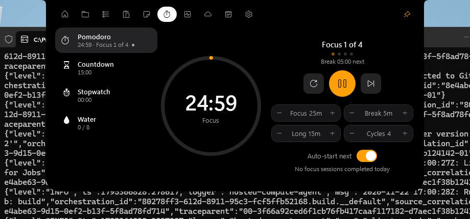</td><td>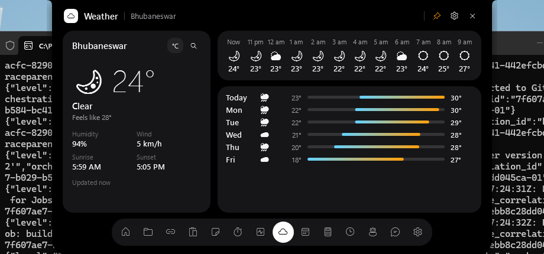</td></tr>
<tr><td>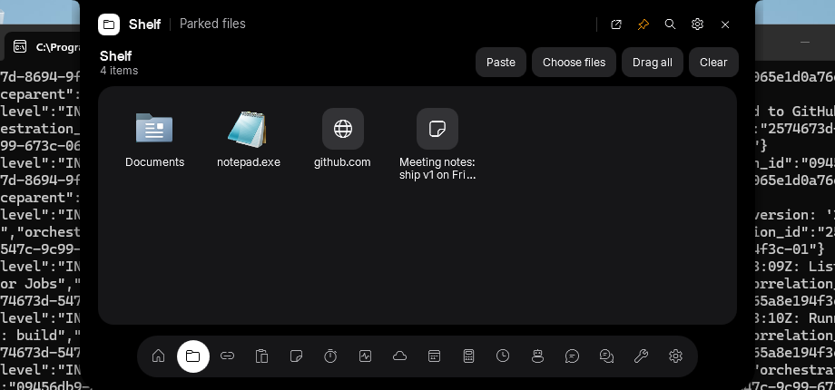</td><td>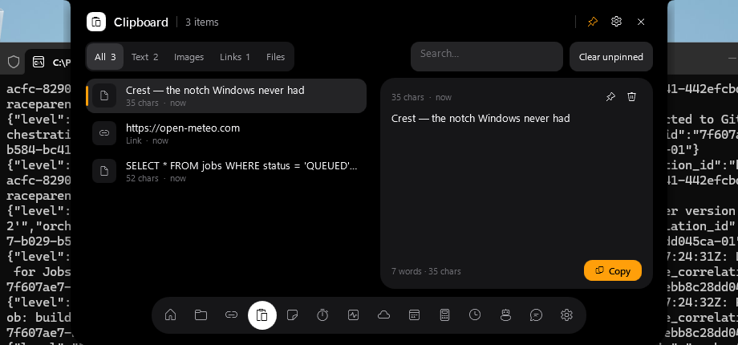</td></tr>
<tr><td>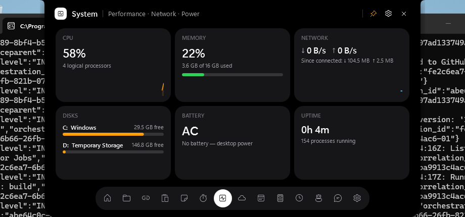</td><td>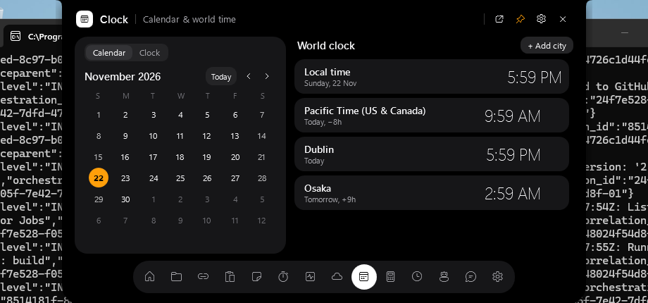</td></tr>
<tr><td>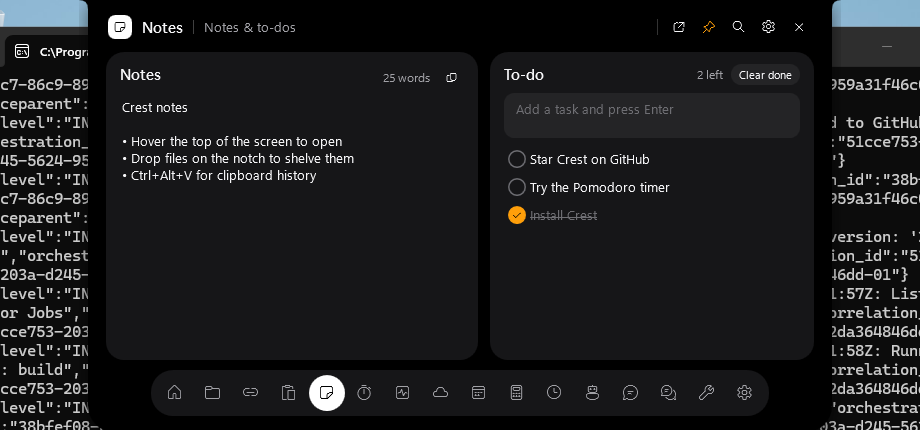</td><td>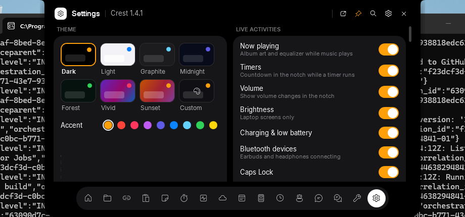</td></tr>
<tr><td>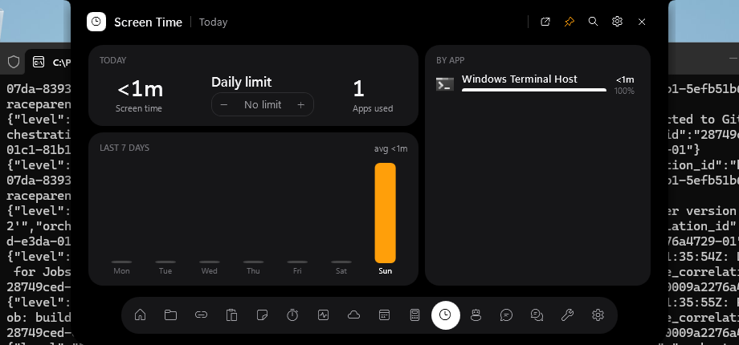</td><td>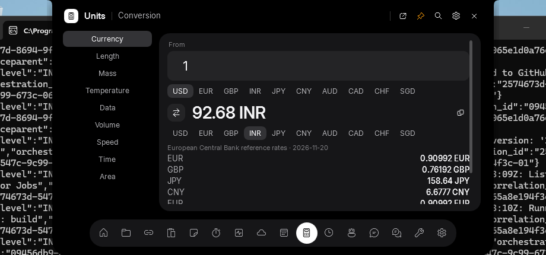</td></tr>
</table>

Live activities:  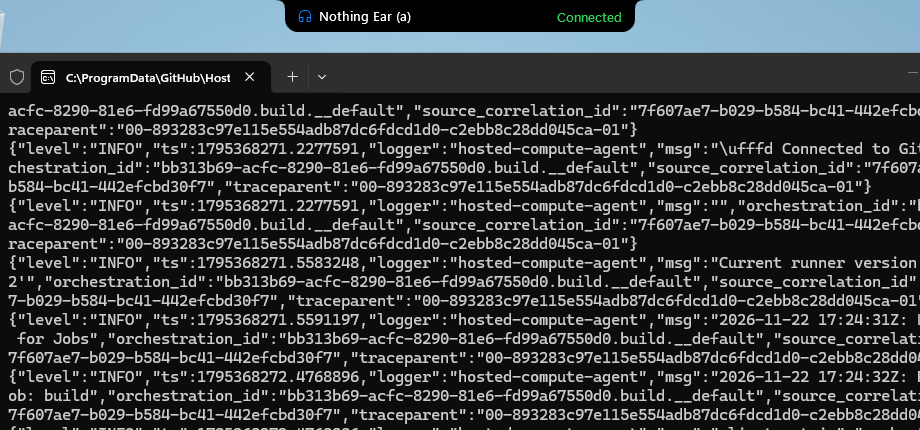  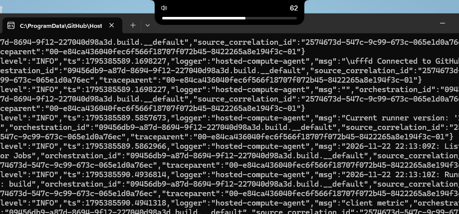

## Install
1. Download **`Crest-win-x64.exe`** from [Releases](https://github.com/rishii-hub/crest/releases/latest). It's one self-contained file with no installer and no .NET needed.
   (`Crest-win-x64-small.exe` is the same app, but it needs the [.NET 8 Desktop Runtime](https://dotnet.microsoft.com/download/dotnet/8.0).)
2. Run it. Windows SmartScreen may warn because the exe isn't code-signed. Click **More info → Run anyway**.
3. Optional: turn on *Settings → Start with Windows*.

**Updates:** Crest checks GitHub for new releases (you can turn this off). When one is out, the notch says so. Install it from *Settings → About & updates* and Crest swaps itself and restarts.

Settings and data are stored in `%AppData%\Crest`. To uninstall, quit from the tray, delete the exe, and delete that folder.

## Privacy
- Nothing leaves your PC except weather requests to Open-Meteo, and only after you set a location.
- Clipboard history stays local. Images are kept in memory only, unless you pin them.
- No analytics and no accounts. The update check is a single request to GitHub's public API, and you can switch it off.

## Known limitations
- Windows doesn't let apps reserve screen space for a notch, so a maximized window's top-centre pixels sit under it. Use **Thin line** idle mode or **Island** style if that bothers you.
- Windows notifications and calendar events can't be mirrored. Those APIs require a packaged (MSIX) app, which is on the roadmap.
- Brightness controls work on built-in laptop panels, not external monitors.
- Bluetooth headphone battery levels aren't exposed by Windows for most devices.

## Build from source
Requires the .NET 8 SDK on Windows 10 2004+ / Windows 11.

```powershell
git clone https://github.com/rishii-hub/crest
cd crest
dotnet run --project src/Crest
# single-file release build:
dotnet publish src/Crest -c Release -r win-x64 --self-contained -p:PublishSingleFile=true -o out
```

`Crest.exe --tour <folder>` walks through every tab and live activity and saves screenshots. CI runs it on every push as a visual smoke test.

### Project layout
```
src/Crest/
  NotchWindow.xaml(.cs)   window, shape, animations, live activities, hover/drag, full-screen detection
  Controls/               NotchShape, SpringEase, RingProgress, Sparkline, BatteryGlyph, Stepper
  Services/               Media (SMTC), Audio (Core Audio), Brightness (WMI), Power, Privacy,
                          Bluetooth, Clipboard, Timers, Weather, stores
  Views/                  one file per tab
  Core/                   Win32 interop, storage, shell thumbnails, helpers
```

## Contributing
Issues and PRs are welcome. Keep it native and light: no new background processes or polling faster than it needs to be. Run `--tour` before opening a PR and attach the screenshots of anything you changed.

## Credits
Inspired by Apple's Dynamic Island, macOS notch utilities like NotchNook and Boring Notch, and the Windows notch apps that came before. Crest is an independent project and isn't affiliated with Apple or Microsoft.

## License
[MIT](LICENSE)
