<p align="center">
  
</p>

<h1 align="center">Crest</h1>
<p align="center"><b>The Dynamic Island / MacBook notch, for Windows.</b><br/>
Native, open source, no account, no telemetry.</p>

<p align="center">
  <a href="https://github.com/rishii-hub/crest/releases/latest"><b>Download for Windows 10/11</b></a> ·
  <a href="#features">Features</a> ·
  <a href="#build-from-source">Build</a>
</p>

<p align="center">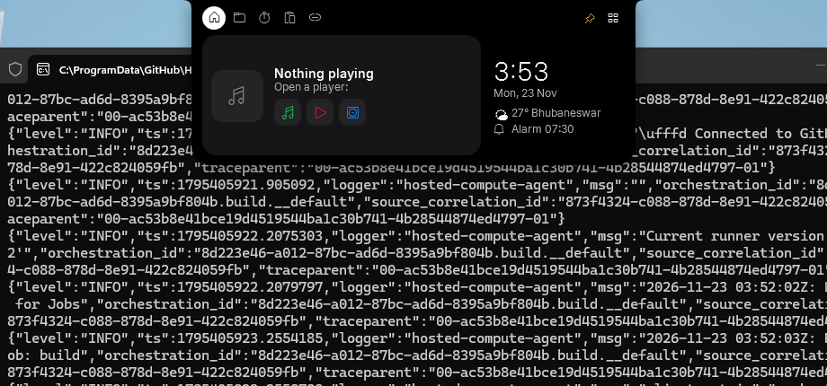</p>

---

Crest puts a small black notch at the top of your screen. It stays out of the way, shows live activities the way an iPhone or MacBook does (music, timers, volume, charging, AirPods-style Bluetooth pop-ups, camera/mic indicators), and opens into a small, minimal island when you hover it. Everything bigger (clipboard history, notes, weather, system stats, settings and the rest) lives in the separate **Crest app** window, so the island never gets cluttered.

It is a native WPF app on .NET 8. No Electron, no browser engine in the background.

## Features

### Live activities (collapsed notch)
| | |
|---|---|
| **Now playing** | Album art + an equalizer driven by the real audio level, tinted with the album's colour. Works with anything that talks to Windows media controls: Spotify, YouTube in Chrome/Edge/Firefox, Apple Music, VLC, Media Player. |
| **Timers** | Running Pomodoro / countdown / stopwatch shown live in the notch. |
| **Volume & brightness HUD** | macOS-style bar in the notch whenever volume or laptop brightness changes. |
| **Charging / low battery** | Plug-in animation with battery level; warnings at 20 %, 10 %, 5 %. |
| **Bluetooth** | "Connected / Disconnected" pop-up for earbuds, headphones and other paired devices. |
| **Privacy indicators** | Orange dot while an app uses the microphone, green for the camera (hover in the expanded view to see which app). |
| **Caps Lock** | On/off indicator. |
| **Copied** | Quick "Copied · Text" confirmation (content hidden by default). |
| **Message** | Your own text, flashed on demand. |
| **Alarms** | Full-width ringing pill with **Snooze** (9 min) and **Stop**. Repeat on chosen days or ring once. |
| **Voice memo** | Red recording pill with elapsed time while the mic records; Stop from the pill. |
| **Screen recording** | Pill while Game Bar records (started from Crest), and a red dot whenever Windows reports an app capturing the screen. |
| **Scripts** | Your automations run with a progress bar and a Stop button, then report ✓ or the exit code. |
| **LAN Drop** | A phone sends a file → the notch asks **Accept / Decline**, then shows transfer progress. |
| **Do Not Disturb** | Pill when Focus Assist turns on or off (Priority only / Alarms only). |
| **Bluetooth battery** | Earbud battery % on connect, where the driver reports it. |
| **Your own** | Anything can post a live activity through the [Live Activity API](#live-activity-api). |

**Two at once.** When two activities run together (a timer and music, say), the notch splits into a main pill and a small bubble beside it, like the iPhone. Swipe an activity sideways (mouse, touch or pen) to hide it; it keeps running. Pull the notch down to pop a tab out as a floating widget.

### The island (hover or click)
Small and quiet, like the Mac notch apps: a row of tiny page icons with a sliding pill, a pin and a button that opens the Crest app. Each page has its own size and the island morphs between them.

| Island page | |
|---|---|
| **Now** | Your own widgets, side by side (see below). By default: music, plus the time, weather, battery and what's next. |
| **Shelf** | Drop files on the island, drag them out later. |
| **Timers** | One-tap 1–45 minute timers, or Pomodoro. |
| **Clipboard** | Your latest copies; click one to copy it again (`Ctrl+Alt+V`). |
| **Links** | Pinned apps and sites. |

Pick which pages the island shows in *Crest → Island*.

**Widgets.** Build the Now page from up to four spaces of widgets, in any order: Music, **Lyrics**, At a glance, Clock, Weather, Battery, Timer, System, Calendar, Quick toggles, Countdown (days until a date you pick), Note and Screen time. The island resizes to fit what you choose. *Crest → Island → Now page widgets.*

**Lyrics.** Synced lyrics for whatever is playing (Spotify, YouTube or YouTube Music in any browser, Apple Music, anything that shows up in Windows' media controls). They appear in the Lyrics widget and, optionally, as a single line in the closed notch while the song plays. Off by default: turning it on sends the song's title and artist to [LRCLIB](https://lrclib.net), a free, open lyrics database. Results are cached on your PC.

<p>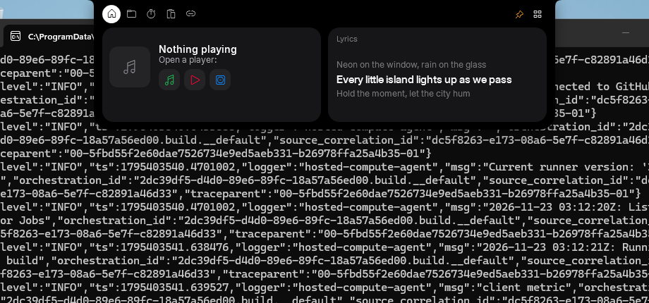 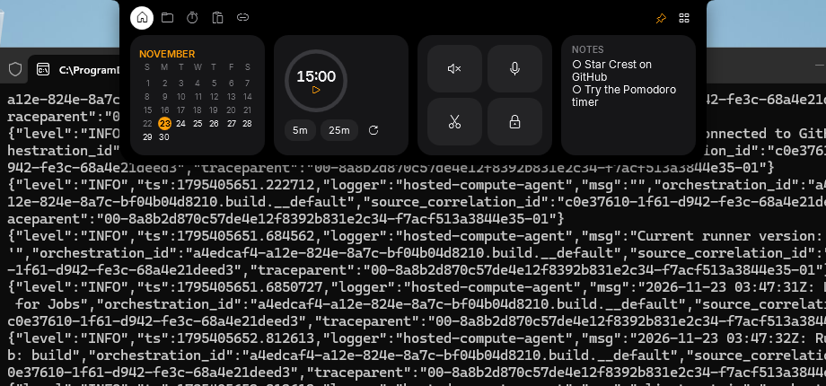</p>
<p>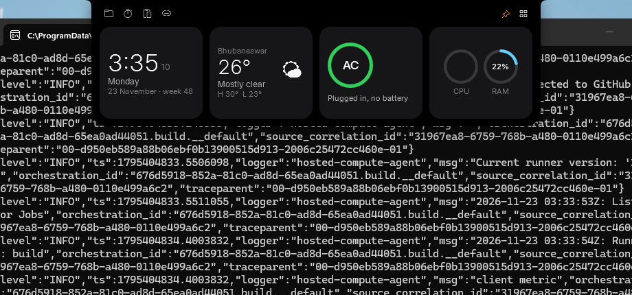 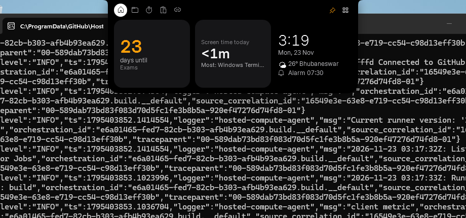</p> `Ctrl+Alt+Space` opens search in the island.

### The Crest app (tray icon, or the ⊞ button on the island)
A normal window with a sidebar, like the Mac notch apps' settings windows, holding every feature at full size and all settings. Any page can be popped out as a floating widget.

| Page | What it does |
|---|---|
| **Search** (`Ctrl+Alt+Space`) | Spotlight for Windows: Start-menu and Store apps (learns what you open), Settings pages, recent files, math (`(12*7+16)/4`), unit and currency conversion (`10 km to mi`, `100 usd in inr`), web search. Arrow keys + Enter; Esc puts focus back where it was. |
| **Assistant** | Opt-in AI prompt bar with streaming replies: local **Ollama**, any OpenAI-compatible endpoint, or Anthropic, with your own key (encrypted with Windows DPAPI). Off by default. Also understands `/timer 10m`, `/alarm 7:30`, `/note`, `/todo`, `/volume 40`, `/open`, `/search` without any AI configured. |
| **Tools** | Voice memos (WAV in Music\Crest Memos), Game Bar screen recording toggle, your scripts (PowerShell, batch, AHK, exe) with live progress, and LAN Drop with a QR code and PIN. |
| **Home** | Now playing with seek bar, a real-time audio spectrum, output device switcher, clock, weather, CPU/RAM rings, focus timer, screen time, quick toggles (Keep awake, Mute, Mic off, Snip, Lock), volume & brightness. |
| **Shelf** | Drag files onto the notch to park them, then drag them out into any app. Paste or choose files too. "Drag all" moves everything at once. |
| **Links** | Web search bar (Google, YouTube, GitHub, Stack Overflow, ChatGPT, Claude, Perplexity, Wikipedia) plus pinned apps, folders and sites. |
| **Clipboard** | History of text, images, links and files with filter chips, search, a preview pane and pinning. Skips content password managers mark as private. |
| **Notes** | Autosaving scratchpad plus a to-do list. |
| **Timers** | Pomodoro (focus / break / long break / cycles / auto-start / daily count), countdown with presets, stopwatch with laps, water tracker with reminders, alarms with repeat days. |
| **System** | CPU, memory, network speed with Wi-Fi name and link rate, disks, battery with health, and uptime, with live graphs. |
| **Weather** | Current conditions, 12-hour strip and 6-day forecast from [Open-Meteo](https://open-meteo.com) (free, no API key). |
| **Clock** | Month calendar, big digital (with seconds) or analog clock, world clocks for any time zone. |
| **Units** | Currency (European Central Bank rates), length, mass, temperature, data, volume, speed, time, area. |
| **Screen Time** | Per-app foreground time today, last 7 days, optional daily limit with a notch alert. Only app names are recorded, never window titles or content. |
| **AI Coding** | Today's Claude Code and Codex token usage, messages, tool calls, sessions, active hours, per-model and 7-day breakdown. Read from the logs those tools already keep on your PC. No prices are guessed. |
| **Message** | Flash your own text on the notch (type-on, scroll or pulse; your colour; 3–30 s). |
| **Appearance · Island · General** | Theme, background, font and eyes; Notch or Island style; visibility Always / Smart (tucks away over maximized apps) / Minimal / Hidden; time & battery in the notch corners; outline; shadow; accent and music colours; module on/off; backup export & import. |

### Themes, backgrounds and eyes
- **Eight themes:** Dark (pure black), Light, Graphite, Midnight, Forest, plus **Vivid** and **Sunset**, which put a slowly moving aurora behind frosted-glass cards. **Custom** takes any panel colour (light colours switch the text to dark automatically) and any accent.
- **Your own background:** a picture, an **animated GIF** or a **video** (muted, looping) behind the open notch, with dim and blur sliders. It only plays while the notch is open, so it costs nothing at rest.
- **Inter** is the default font (bundled; Segoe UI, Bahnschrift or any installed font are one click away).
- **Eyes:** the resting notch can watch your cursor. Five styles: Pill, Bubble, Honey (pupils widen as you come close), Jade (cat slits that open round) and Robot (glowing LEDs in your accent colour). They blink, glance around when you're still, and doze off when you're away.

<p>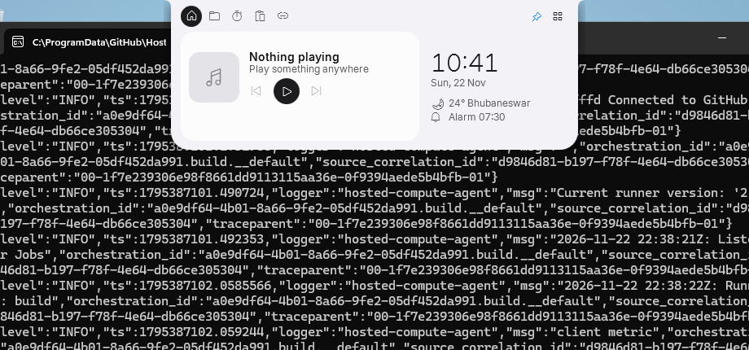 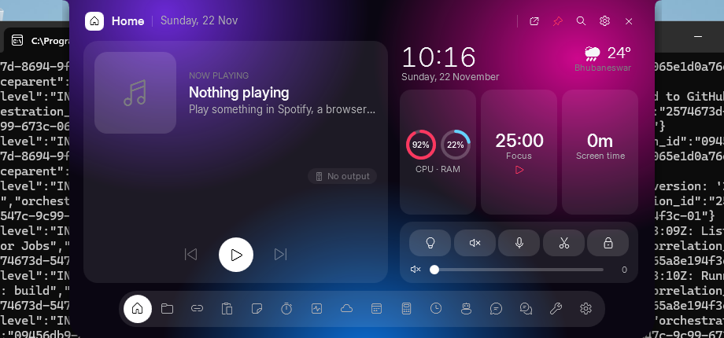</p>
<p>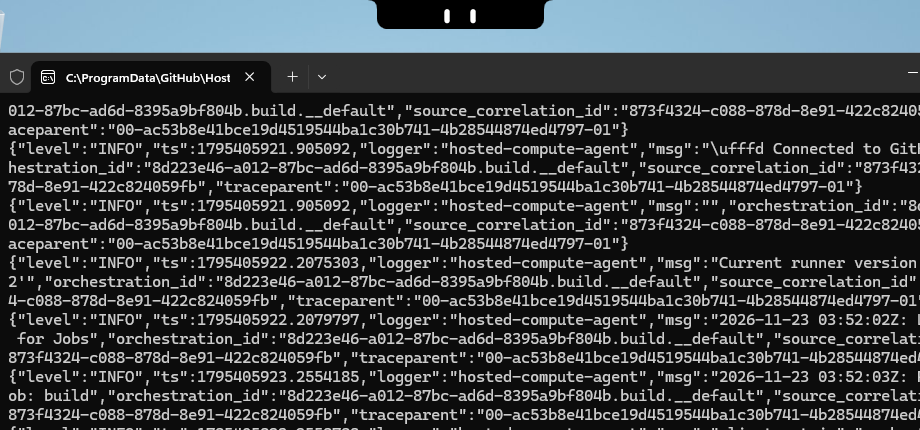 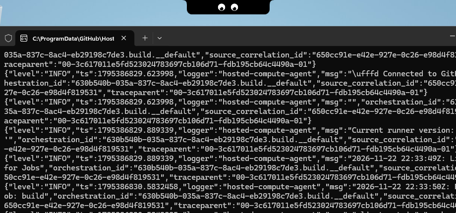 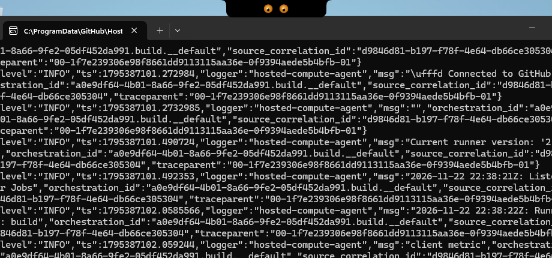 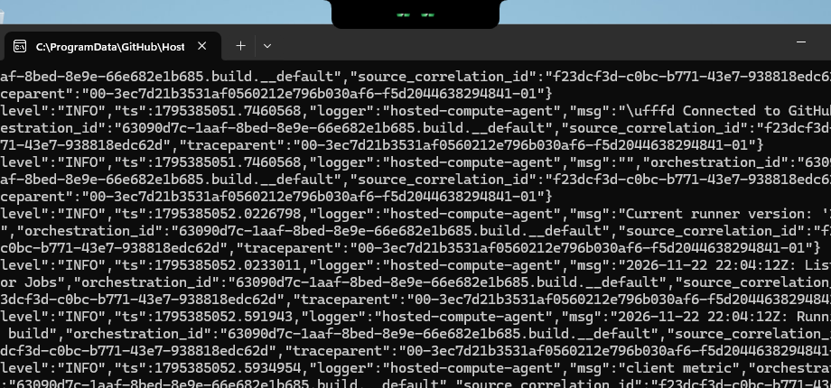</p>

### Behaviour details
- **Stays out of your way.** It hides automatically for full-screen games, videos and presentations. **Smart** visibility shrinks it to a thin line whenever the app under it is maximized, so browser tabs stay clickable.
- **Doesn't steal focus.** Clicking buttons in the notch leaves your current app focused. Only text fields take keyboard focus, and focus goes back to your app when the notch closes.
- **Spring animations** tuned to match the iPhone Dynamic Island.
- **Per-monitor DPI aware**: sharp on 100 %–200 % scaling and mixed-DPI setups. It can follow the display your cursor is on.
- **Hide from screen capture** (optional): the notch won't appear in recordings, screenshots or Teams/Zoom/Meet shares.
- **Tray icon** with open, settings, hide, autostart and quit.
- **Shortcuts:** `Ctrl+Alt+N` open/close · `Ctrl+Alt+Space` search · `Ctrl+Alt+V` clipboard · `Ctrl+Alt+P` start/pause Pomodoro · `Esc` close.
- **OLED black + camera cutout** options, so the notch blends into a laptop bezel.

## Live Activity API
Any script or app can put its own live activity in the notch through a named pipe, `\\.\pipe\CrestLiveActivity` (current user only). Send one JSON object per line:

```powershell
$p = New-Object System.IO.Pipes.NamedPipeClientStream(".", "CrestLiveActivity", "InOut")
$p.Connect(2000); $w = New-Object System.IO.StreamWriter($p); $w.AutoFlush = $true
$w.WriteLine('{"id":"build","glyph":"🚀","title":"Building","value":"3/5","progress":0.6,"color":"#30D158","actions":[{"id":"cancel","label":"Cancel"}]}')
# ...later
$w.WriteLine('{"op":"end","id":"build"}')
```

Or from anything that can start a process: `Crest.exe --activity "{\"id\":\"build\",\"title\":\"Done\",\"op\":\"toast\"}"`.

| Field | |
|---|---|
| `op` | `show` (default), `update`, `end`, `toast` |
| `id` | your activity's id (repeat it to update) |
| `glyph`, `title`, `value`, `color` | icon (emoji or Segoe Fluent glyph), text, accent `#RRGGBB` |
| `progress` | 0–1 progress bar; `"elapsed": true` shows a clock counting up from now instead |
| `priority`, `ttl`, `tab` | ordering vs. other activities, auto-end after N seconds, tab to open on click |
| `actions` | up to two buttons; clicks come back on the same pipe as `{"event":"action","id":"build","action":"cancel"}` |

## Screenshots
Island pages:

<p>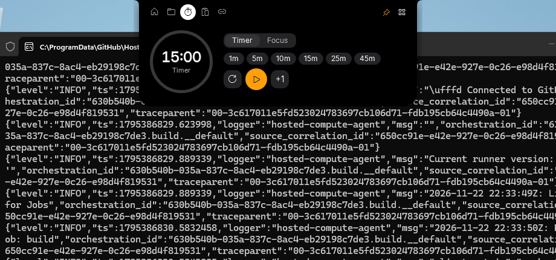 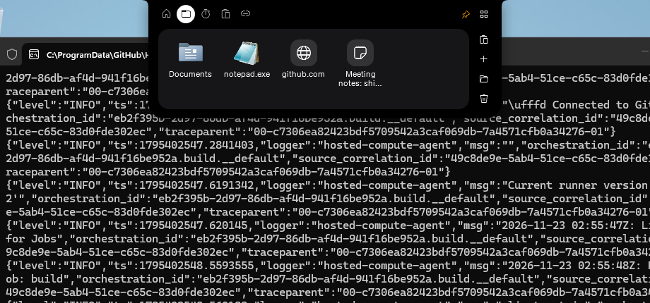</p>

The Crest app:

<table>
<tr><td>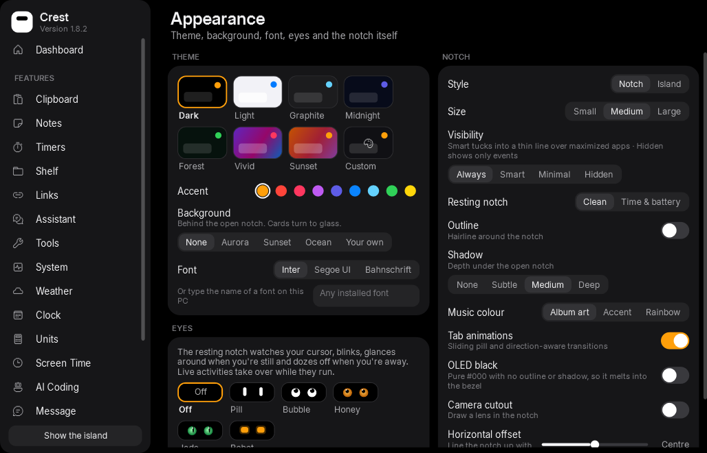</td><td>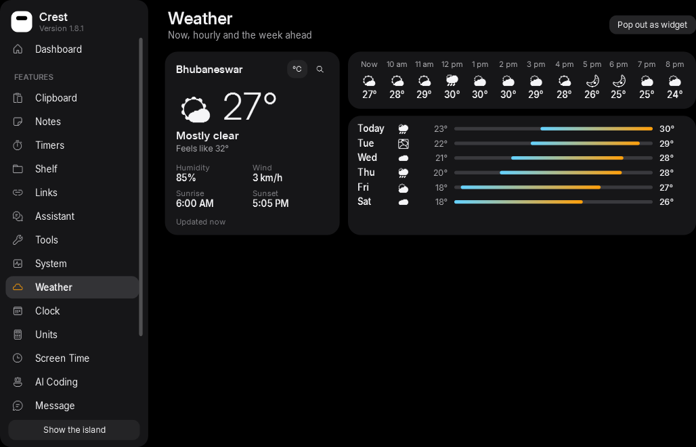</td></tr>
<tr><td>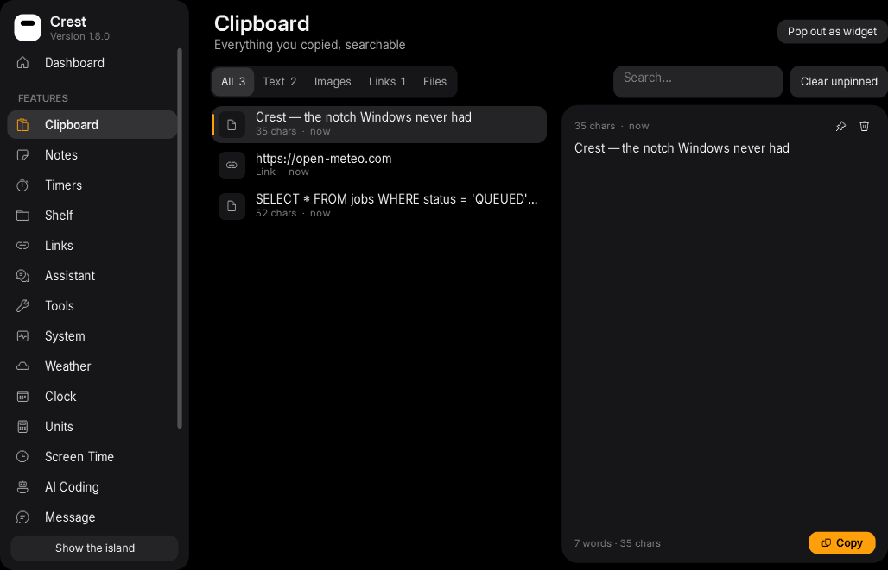</td><td>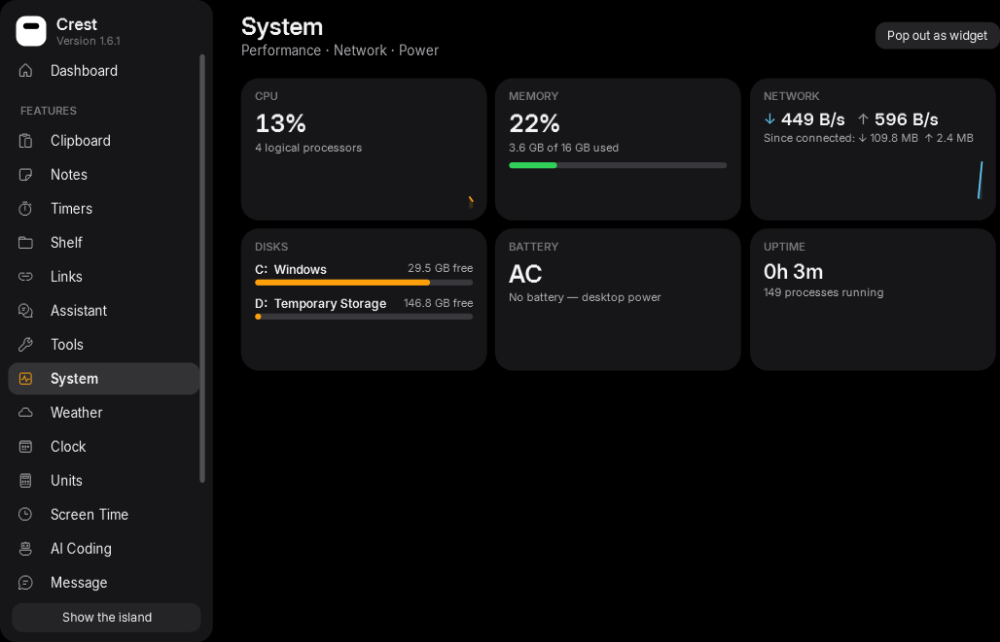</td></tr>
<tr><td>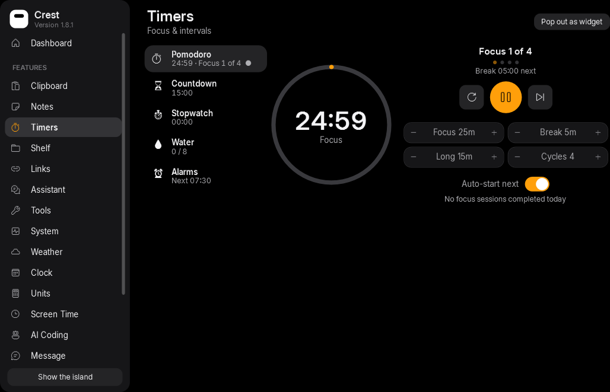</td><td>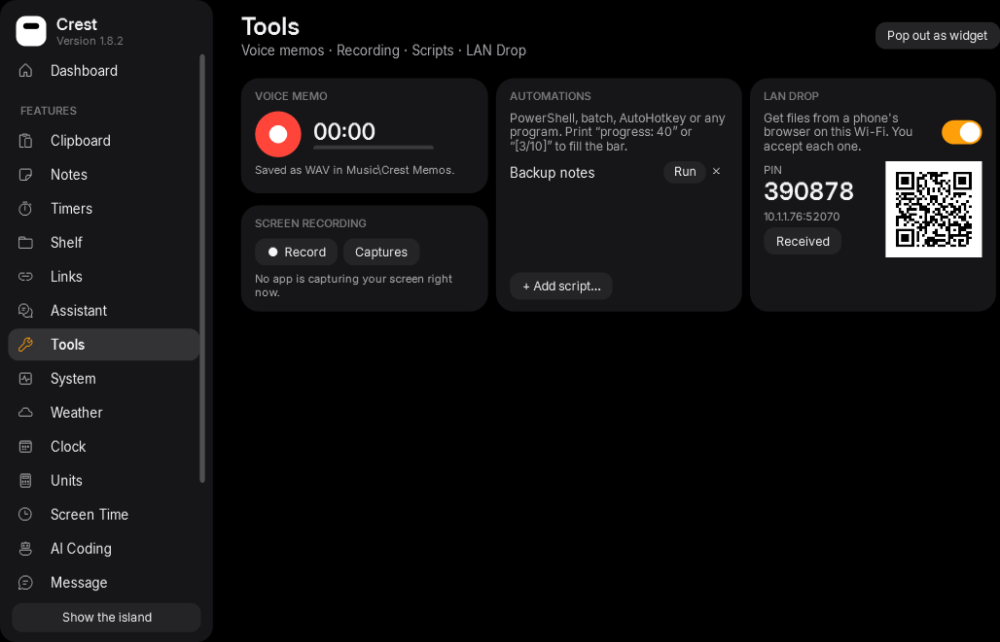</td></tr>
</table>

<table>
<tr><td>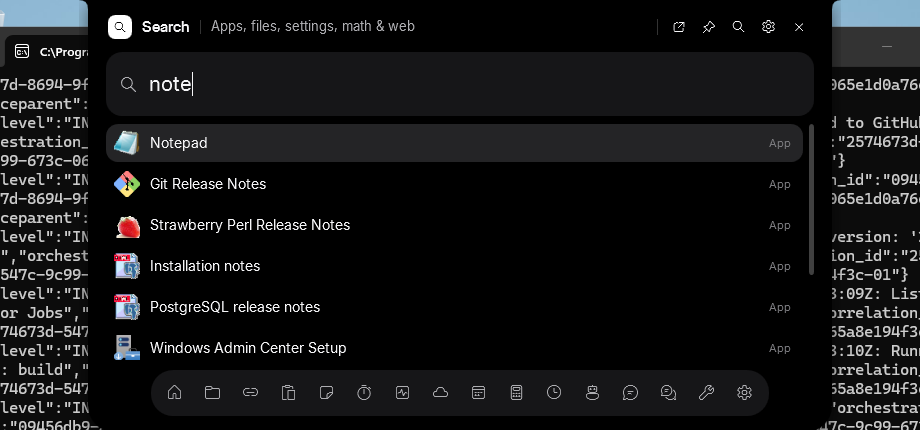</td><td>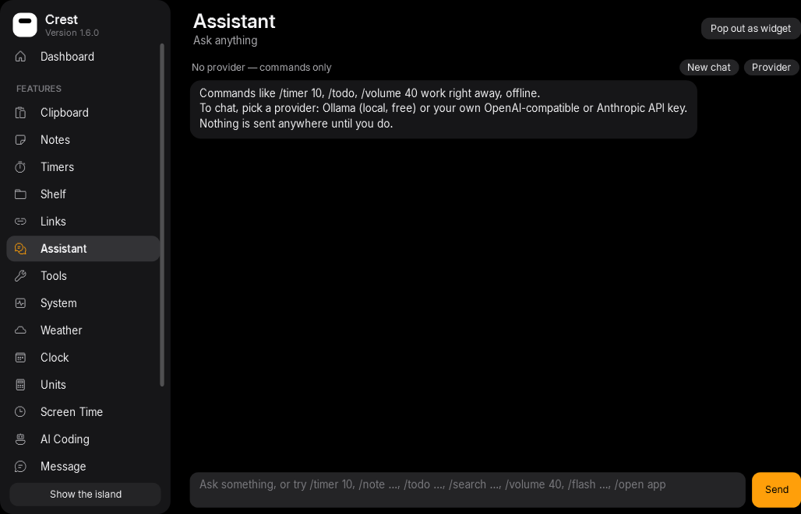</td></tr>
</table>

Live activities: 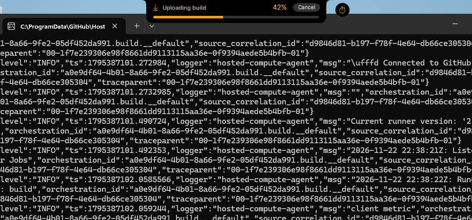 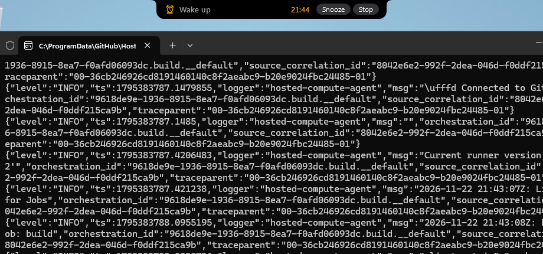 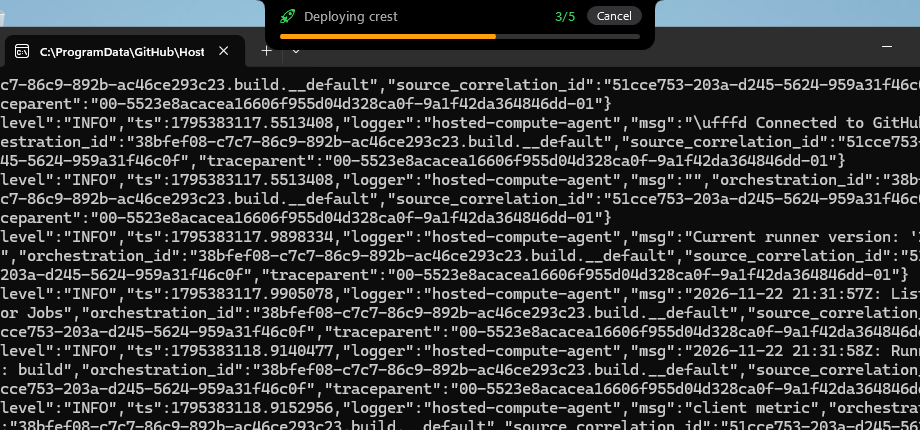 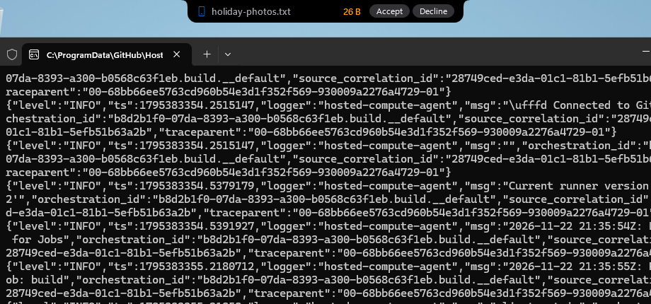 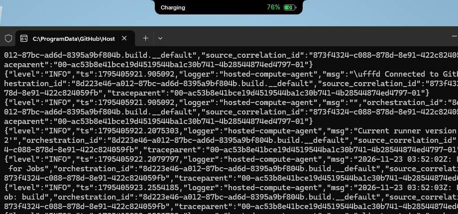  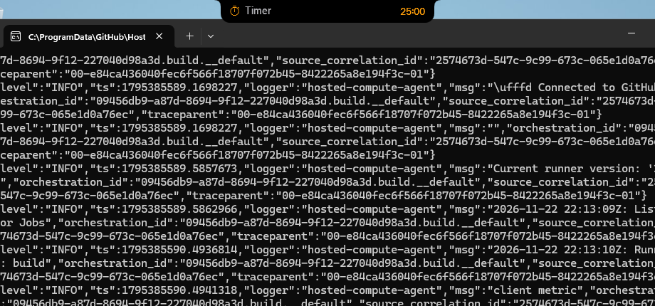 

## Install
1. Download **`Crest-win-x64.exe`** from [Releases](https://github.com/rishii-hub/crest/releases/latest). It's one self-contained file with no installer and no .NET needed.
   (`Crest-win-x64-small.exe` is the same app, but it needs the [.NET 8 Desktop Runtime](https://dotnet.microsoft.com/download/dotnet/8.0).)
2. Run it. Windows SmartScreen may warn because the exe isn't code-signed. Click **More info → Run anyway**.
3. Optional: turn on *Settings → Start with Windows*.

**Updates:** Crest checks GitHub for new releases (you can turn this off). When one is out, the notch says so. Install it from *Settings → About & updates* and Crest swaps itself and restarts.

Settings and data are stored in `%AppData%\Crest`. To uninstall, quit from the tray, delete the exe, and delete that folder.

## Privacy
- Nothing leaves your PC except weather requests to Open-Meteo (after you set a location), currency rates from the ECB, song title and artist to LRCLIB if you turn lyrics on, and Assistant prompts, which go only to the AI endpoint you configure yourself.
- LAN Drop is off by default. When on, it listens on your local network only, every upload needs the 6-digit PIN, five wrong PINs lock that device out, and every file waits for you to press Accept.
- The Live Activity pipe only accepts connections from your own Windows user.
- Clipboard history stays local. Images are kept in memory only, unless you pin them.
- No analytics and no accounts. The update check is a single request to GitHub's public API, and you can switch it off.

## Known limitations
- Windows doesn't let apps reserve screen space for a notch, so a maximized window's top-centre pixels sit under it. Use **Thin line** idle mode or **Island** style if that bothers you.
- Mirroring Windows notifications and calls needs the optional [MSIX build](packaging/README.md), because Windows only gives notification access to packaged apps. Even then it is read-only: Windows doesn't let one app press another app's Accept/Decline buttons.
- Screen recording uses Xbox Game Bar, which records the app in front rather than the whole desktop. Other recorders show up through the capture indicator only if they use Windows' graphics-capture API.
- There is no Windows API for Nearby Share, so LAN Drop works with any phone browser instead.
- Brightness controls work on built-in laptop panels, not external monitors.
- Bluetooth battery % only appears for devices whose driver reports it to Windows (many hands-free/LE devices do, some don't).

## Build from source
Requires the .NET 8 SDK on Windows 10 2004+ / Windows 11.

```powershell
git clone https://github.com/rishii-hub/crest
cd crest
dotnet run --project src/Crest
# single-file release build:
dotnet publish src/Crest -c Release -r win-x64 --self-contained -p:PublishSingleFile=true -o out
```

`Crest.exe --tour <folder>` walks through every tab and live activity and saves screenshots. CI runs it on every push as a visual smoke test.

### Project layout
```
src/Crest/
  NotchWindow.xaml(.cs)   window, shape, animations, live activities, hover/drag, full-screen detection
  Controls/               NotchShape, SpringEase, RingProgress, Sparkline, BatteryGlyph, Stepper
  Services/               Media (SMTC), Audio (Core Audio), Brightness (WMI), Power, Privacy,
                          Bluetooth, Clipboard, Timers, Weather, stores,
                          Hub (search index, calculator, units, assistant), Activity (spectrum, alarms,
                          recorder, automations, pipe API), Ecosystem (Focus Assist, outputs, LAN Drop, mirror)
packaging/                optional MSIX manifest + build script
  Views/                  one file per tab
  Core/                   Win32 interop, storage, shell thumbnails, helpers
```

## Contributing
Issues and PRs are welcome. Keep it native and light: no new background processes or polling faster than it needs to be. Run `--tour` before opening a PR and attach the screenshots of anything you changed.

## Credits
Inspired by Apple's Dynamic Island, macOS notch utilities like NotchNook and Boring Notch, and the Windows notch apps that came before. Crest is an independent project and isn't affiliated with Apple or Microsoft.

## License
[MIT](LICENSE). The bundled [Inter](https://rsms.me/inter/) font is © The Inter Project Authors, under the [SIL Open Font License 1.1](src/Crest/Assets/Fonts/Inter-LICENSE.txt).
